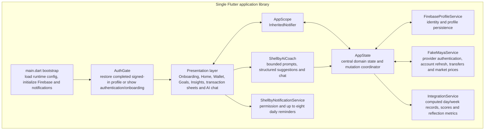

# Shelby Updated System Architecture

## Purpose and scope

This architecture replaces a proposal-level system diagram with a source-based view of the Shelby prototype as implemented in this repository. It describes the current Flutter client, its managed Firebase services, the optional FakeMaya provider connection, the AI routes, and device-level services. "Shelby" is used in this document as the product name; several repository identifiers and the application label use the spelling `Shellby`.

The application is **not** a microservice system. Its feature logic, state management, calculations, integrations, and presentation are delivered in one Flutter mobile application. The cloud components are limited to Firebase Authentication, Cloud Firestore, and one Firebase HTTPS Function used to proxy Gemini requests.

## 1. System context and deployment architecture

```mermaid
flowchart LR
  user[User]

  subgraph device[User device: Android or iOS]
    app[Shelby Flutter application]
    os[Operating-system services\nnotification permission, timezone and scheduled local notifications]
    qwen[Optional local Qwen runtime\nllamadart isolate and app-support model copy]
  end

  subgraph firebase[Firebase project: shelby-1b1d8]
    auth[Firebase Authentication\nemail/password and Google Sign-In]
    firestore[Cloud Firestore\nprofiles/{uid}]
    function[HTTPS Cloud Function\ngeminiGenerateContent]
    secret[Firebase Secret Manager\nGEMINI_API_KEY]
  end

  subgraph external[External systems]
    fakemaya[FakeMaya Supabase service\nauthentication, wallet state, transactions and goal buckets]
    gemini[Google Gemini GenerateContent API]
    coingecko[CoinGecko API\nBTC and NVDA PHP market prices]
  end

  user --> app
  app <--> os
  app <--> auth
  app <--> firestore
  app --> function
  function --> secret
  function --> gemini
  app -. optional account link, refresh and allocation .-> fakemaya
  app -. on-demand investment price refresh .-> coingecko
  app -. configured or fallback AI inference .-> qwen
```

### Reading the diagram

- Solid arrows identify the normal product path. A signed-in user authenticates with Firebase, and Shelby reads and writes that user's profile document in Cloud Firestore.
- The normal cloud AI route is `Shelby app → Firebase HTTPS Function → Gemini`. The function holds the Gemini key through Firebase Secret Manager, so the key does not need to be sent to the mobile UI.
- Dotted arrows identify optional or conditional paths. A user can use Shelby with manually entered transactions and never link FakeMaya. CoinGecko is consulted only when investment prices are refreshed. The Qwen route is a local fallback/alternative, not a remote service.
- Device notifications are scheduled locally on the phone. There is no notification server, background job queue, or server-side push-notification component in this repository.

## 2. Flutter application design



This is a logical component diagram, not a claim that each box is separately deployed. The repository uses Dart `part` files declared from `lib/main.dart`; `AppState` is the main in-memory source of truth and not a separate backend service. `AppScope` publishes its changes to the widgets through `InheritedNotifier`.

### Presentation layer

After onboarding, `MainShell` exposes four primary destinations: **Home**, **Wallet**, **Goals**, and **Insights**. It also provides a global manual-transaction entry point and access to Shelby chat. Authentication and the preparation/onboarding screens sit before this shell.

The presentation layer does not independently calculate or persist financial data. It asks `AppState` to perform the relevant operation, reacts to state notifications, and displays the resulting balance, action progress, transaction labels, goal status, or reflection result.

### Central domain state: `AppState`

`AppState` contains the user's preparation profile, consent choices, selected motivation, goal and action configuration, onboarding baselines, balances, funds/jars, bills, manual account balances, transactions, transaction-label rules, linked FakeMaya account state, action-field values, and reminder settings. It also contains the operations that update those values.

For example, when a user records a manual transaction or labels a linked transaction, `AppState` updates the transaction and its label rule, saves the profile when the user is signed in, and calls `notifyListeners()`. When the user allocates money to a supported linked goal bucket, `AppState` asks `FakeMayaService` to transfer the amount; when no linked provider bucket applies, it updates the local goal-bucket override instead. The UI therefore remains a requester and renderer, while financial state transitions stay in one place.

### Derived reflection and insights

`IntegrationService.fromState(AppState)` derives day and week records from the current transaction and jar-ledger data. It calculates reflection measures such as jar integrity, buffer resilience, refill consistency, cash flow, category spending, and goal/action progress. These records are computed in the client at the time an insight is viewed; they are not stored as a separate analytics database or sent to an analytics service by the code in this repository.

Only appropriately labelled and non-excluded transactions contribute to the applicable insight calculations. This makes transaction labelling a functional part of the reflection process, rather than a cosmetic tag.

## 3. End-to-end data flows

### A. Account creation, sign-in, and profile restoration

1. The application bootstrap initializes Firebase and the local notification plugin before `ShellbyApp` is run.
2. `AuthGate` asks `AppState.restoreSignedInUser()` whether Firebase has a current user.
3. If a user exists, `FirebaseProfileService` loads `profiles/{uid}` from Cloud Firestore. Shelby accepts the account into the main application only when the profile indicates that onboarding is complete.
4. `AppState._applyProfileMap()` rebuilds the in-memory state from the document. If a FakeMaya link is stored, Shelby attempts to refresh it and refreshes the account-derived display state.
5. Subsequent state changes call `FirebaseProfileService.saveProfile()`, which writes the profile map back to the same Firestore document. Firestore security rules limit reads and writes to an authenticated user whose UID matches the document ID.

### B. Financial-data collection, labelling, and allocation

**Manual path.** The user creates a cash or manual-account transaction from the application. `AppState.addManualCashTransaction()` validates the available balance for an outflow, records a timestamped transaction together with category and source, updates the appropriate local balance, persists the profile, and refreshes the UI.

**Optional FakeMaya path.** The user signs in to the FakeMaya demonstration provider and selects which eligible accounts to sync. `FakeMayaService` authenticates against the provider's Supabase endpoint, retrieves wallet/account summaries and transactions, and stores the link/session summary through the user profile. On a later refresh, the service refreshes the provider session and account summary. Linked account use is optional; Cash on Hand remains a manual source.

**Labelling and goals.** The user assigns a category, source, optional subcategory, tag, and note to a transaction. Shelby retains a pattern rule for future matching and may exclude a transaction from Insights on the user's instruction. The labelled data feeds goal action progress and the reflection calculations. Where a linked provider account and an approved goal bucket are available, a user-triggered allocation or withdrawal is executed through FakeMaya; otherwise the appropriate local balance/goal bucket is changed. Shelby does not automatically move funds merely because it generated a recommendation.

### C. Insight and action cycle

1. Collected transactions, labels, fund/jar events, selected actions, and onboarding baseline values are held in `AppState` and persisted in the user's Firestore profile.
2. `IntegrationService` transforms the current state into meaningful financial records and progress indicators.
3. The Insights and Goals interfaces explain current results, including spending, balances, fund use, and configured action status.
4. When the user requests guidance, `ShellbyAiCoach` builds a bounded, feature-specific prompt from the relevant state. Its action-stage prompts constrain the model to the app's supported actions and return structured suggestions.
5. The user may accept, edit, or ignore a suggestion. A resulting plan or money movement occurs only through a normal explicit Shelby action.

### D. AI request routing

The application loads runtime configuration from Dart defines and the bundled `.env` asset. With the normal configuration, it sends the prompt body to the Firebase HTTPS function. That function validates the request method and model name, retrieves `GEMINI_API_KEY` from Secret Manager, and forwards the request to Gemini's `generateContent` endpoint.

The implementation also contains two conditional alternatives that must be represented accurately:

- If a `GEMINI_API_KEY` is supplied to the Flutter runtime without a proxy URL, the application can call Gemini directly from the device. This is an implemented development/configuration route, but it puts a provider key in the client configuration and is not the intended production trust boundary.
- If Gemini is unavailable or not configured, the code can initialize a local Qwen GGUF model with `llamadart` in a Dart isolate. It copies the bundled model asset into the app-support directory before inference. However, the current `pubspec.yaml` comments out `assets/models/`; therefore the local path becomes usable only after that asset directory is declared and the model is included in the build.

### E. Reminders and device services

The user grants notification permission through the application. `ShellbyNotificationService` obtains the device timezone (falling back to `Asia/Manila`), schedules up to eight daily local reminders, and cancels/replaces the existing reminders when settings change. Android declares notification and boot-complete support so scheduled reminders can be restored by the plugin. This functionality occurs on the device; it is neither Firebase Cloud Messaging nor a server-scheduled notification system.

## 4. Data stores, ownership, and trust boundaries

| Boundary or store | Current implementation | Data and responsibility |
| --- | --- | --- |
| On-device runtime memory | `AppState` | Active user profile, balances, transactions, labels, goals, derived display values, and UI state while the application is running. |
| Cloud Firestore | One document at `profiles/{uid}` | The persisted Shelby profile map, including onboarding/consent data, ledgers, manual transactions, label rules, goal configuration, linked-account metadata, and the serialized FakeMaya link. It is the application's main Shelby cloud store. |
| Firebase Authentication | Firebase Auth plus Google Sign-In | Email/password account identity and Google identity federation. It supplies the UID used by the Firestore profile. |
| Firebase Cloud Function and Secret Manager | `geminiGenerateContent` | The production-oriented Gemini proxy. The function has access to the Gemini key through a Firebase secret and forwards the bounded request upstream. |
| FakeMaya Supabase service | External demonstration provider | Provider authentication/session refresh, wallet state, transaction summaries, linked savings/time-deposit/personal-goal buckets, and linked-account transfers. It is not part of Firebase or Cloud Firestore. |
| CoinGecko | External public market-data API | PHP-denominated BTC and NVDA price/price-change lookups used when the app refreshes investment prices. |
| Device file storage | Application-support directory | A copied local GGUF model only when the Qwen fallback is bundled and invoked. It is not used as a general local profile database. |

## 5. Architecture claims to revise in the paper

The following wording keeps the paper aligned with the repository:

- Describe Shelby as a **Flutter client with managed Firebase services and optional third-party integrations**, not as a collection of independently deployed backend modules.
- Describe Firestore as a **single user-owned profile document** that serializes the current prototype state, rather than as separate normalized transaction, budget, goal, and analytics collections.
- Identify **FakeMaya** as the optional demonstration e-wallet/provider integration. Do not describe a live commercial e-wallet, bank connection, or universal financial-data aggregator.
- Include **manual transaction recording** as a complete first-class collection route. Linking FakeMaya is not a precondition for using the application.
- Include **transaction labelling** between data collection and insight generation, because the insight logic relies on labelled, non-excluded transactions.
- Identify the **Firebase HTTPS Gemini proxy** as the intended secure AI route; qualify direct client-side Gemini access as a configuration fallback rather than the production design.
- Identify **local Qwen** as implemented fallback code that requires the model asset to be enabled in `pubspec.yaml` to operate in a shipped build.
- Include **CoinGecko** when describing investment price refreshes.
- Describe reminders as **local device notifications**. Do not claim server-side push notifications, a messaging service, or an event queue.
- Exclude peer-to-peer dashboards, community validation, voting, cooperative benchmarking, or a separate social-data backend from the implemented architecture. They are not present in this repository.

## 6. Paper-ready architecture description

Shelby is implemented as a Flutter mobile application for Android and iOS. The application presents onboarding, transaction collection, wallet, goals, insights, and conversational guidance through a single client application. Its central `AppState` object coordinates user financial information, selected goal actions, manual and linked transactions, labels, funds, and balances, and publishes updates to the interface through `AppScope`. The reflection layer derives insight and progress measures in the client from the current labelled transaction and fund data.

Firebase provides the managed identity and persistence layer. Users authenticate through Firebase Authentication using email/password or Google Sign-In, and Shelby stores each user's persisted prototype state in a Firestore document at `profiles/{uid}`, protected by UID-based security rules. Gemini guidance normally follows a server-mediated path: the mobile application sends a bounded request to a Firebase HTTPS Function, which retrieves the Gemini key from Firebase Secret Manager and forwards the request to Google's Gemini API.

Financial data can be collected manually or, with explicit user consent, from the optional FakeMaya demonstration provider. Shelby refreshes selected provider accounts and transactions, lets users label and classify the records, and uses the resulting data to update goal progress and insights. User-triggered allocations can update a linked FakeMaya goal bucket when available; otherwise Shelby maintains the corresponding local goal balance. Local reminders are scheduled directly on the device, and investment-price refreshes call CoinGecko. The code also contains a local Qwen inference fallback, which requires the GGUF asset to be included in the application build.

## 7. Repository evidence used for this architecture

| Evidence | What it establishes |
| --- | --- |
| `lib/main.dart` | Bootstrap order, runtime configuration, single-library `part` structure, Firebase initialization, default Gemini proxy, and Qwen asset path. |
| `lib/core/app_state.dart` and `lib/core/app_scope.dart` | Central state ownership, profile restoration/persistence, manual transactions, transaction labels, FakeMaya linking/refresh, allocation logic, and UI notification mechanism. |
| `lib/features/auth/auth_screens.dart`, `lib/features/preparation/`, and `lib/features/home/` | Authentication/onboarding entry flow and the implemented UI areas. |
| `lib/services/firebase_profile_service.dart` and `firestore.rules` | Firebase Auth/Firestore profile access and user-owned document authorization. |
| `lib/services/fakemaya_service.dart` | Supabase-based FakeMaya connection, account operations, and CoinGecko price requests. |
| `lib/services/integration_service.dart` | Client-side records, metrics, and the dependence of insights on labelled data. |
| `lib/services/shellby_ai_coach.dart` and `functions/index.js` | Bounded AI orchestration, Gemini proxy/direct/local routes, and Secret Manager-backed function proxy. |
| `lib/services/notification_service.dart` and `android/app/src/main/AndroidManifest.xml` | On-device reminder scheduling, permissions, timezone handling, and Android receivers. |
| `pubspec.yaml` | Declared packages/assets and the currently disabled `assets/models/` declaration. |
